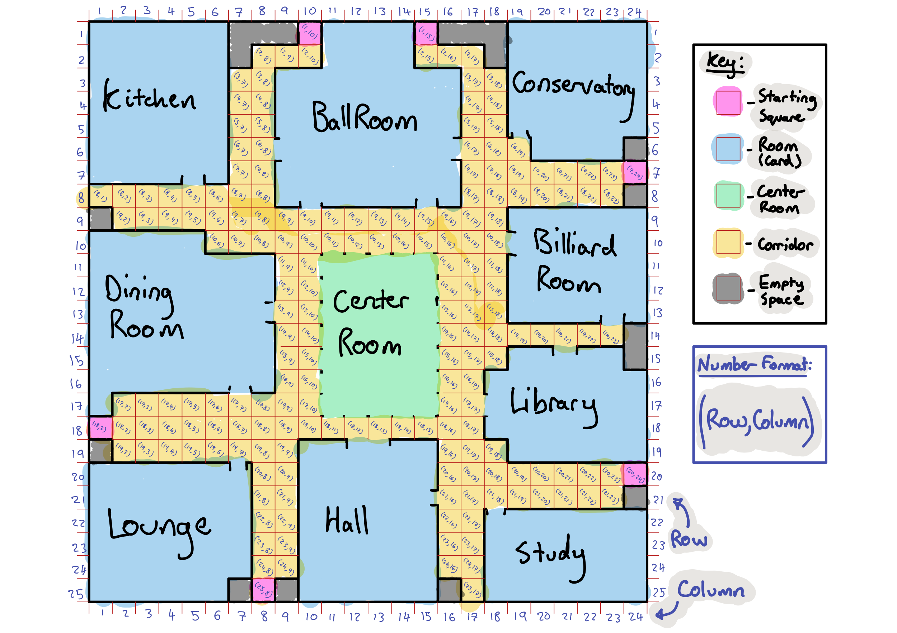

# Design Log for COM2016 Cluedo

### 19.03.2026

## Common elements of a computer game: [1]

- Initial setup: get the game ready to play. This might mean setting the pieces on a chess board, dealing out cards, or rolling dice to see who goes first.

- Gameplay: flow of gameplay is controlled by a game loop, which keeps the game moving and doesn't end until the game is over. The game loop ensures that the following happens: 
    - The user input is gathered and processed
    - The game stage is updated based on readtions to the user input. This may include checking for end-of-game conditions. 
    - Any required output changes are made to reflect the new game state. 
    - Game loop repeats

- Game ending: how the game ends depends on the game itself. Whether capturing the enemy king in checkmate, achieving a certain score in a card game, or having your piece cross the line in a board game, certain conditions determine the end of the game and the winner. 

All games have a game loop. For example, in a chess game, you first set the pieces on the board and declare the current player. Then the game loop begins: 

- Current player moves a piece, updating the game state.
- Checkmate conditions is checked to determine if the game is over. 
- The current player is updated and the loop starts again. 

Real-world games blur the lines between the individual elements of a game. For example, moves in chess update both the game state and the game output. Despite this, the key elements of the game are always present. With them in mind, you can begin writing your own game. 

## Description of the Cluedo Game: [1] [2] [3]

Note for further consideration: 

If in room, and other player tokens are on exits of room, is player in room able to exit? If not, are they able to make a suggestion or do they forfit their turn until other players move? How to track if player has just entered a room versus was in same room from previous turn? 

- Game setup: 
    - Game asks for number of players.
    - Requests names for each user.
    - Player tokens are put in starting positions. 
    - WHO, WHAT, and WHERE cards are seperated and shuffled.
    - Top card from each pile is put into the Yellow Murder Envelope.
    - Remaining cards are combined and shuffled.
    - Cards are dealt evenly among other players. If cards don't divide exactly between players, leftover cards are put face up at the side of the board.
    - Each player crosses off the cards they have been dealt and any leftover cards that are faceup on the table from their CLUE sheet. 
    - **(Red bonus cards are shuffled and placed at the side of the board for bonus moves during play. Not included in original CLUE gameplay).
    - Every player rolls the dice. Highest roller goes first. 

- Player's Turn: 
    - Roll the dice. 
    - Check valid moves (if moved to a room by other player last turn, staying where you are and asking a question counts as a valid move). 
    - Move character token to a valid space. 
    - IF (in room): 
        - Stop and ask a CLUE question about one suspect, one weapon, and room character token is in. 
        - Bring the suspect's character token and weapon token being asked about into the room. 
        - The player on your left must be the first to try to answer your question. If they have any of the cards you asked about they must show one of them. Never show more than one card. 
        - If they don't have any of the cards asked about, they say "I cannot answer"
        - Question is passed left to the next player. 
        - Repeat until either one card is shown or have cycled through every player. 
        - If shown card, mark it off CLUE sheet. 
        - End turn. 
    - IF (in corridor):
        - End turn.
    - IF (center of board): 
        - Select which WHO, WHAT, WHERE cards for accusation.  
        - Read accusation aloud: "I accuse WHO, with the WHAT in the WHERE".
        - Check cards in Envelope. 
        - IF (accusation correct): 
            - WIN
        - IF (accusation incorrect):
            - Player is 'removed' (return cards to the Envelope. Keep cards hidden and keep answering other player's questions. Do not ask any further questions or make any further accusations).
            - Game loop continues.    
    - **IF(red bonus card):
        - Pick up top red bonus card. 
        - Follow instructions on card.
        - Place card in discard pile. 
        - End turn. 
    - Move to next player's turn. 

### 20.03.2026

## Key objects/parts of the game:

- Players -> clue sheet? 
- WHO, WHAT, WHERE cards. 
- Dice.
- **(Red bonus cards).
- Board. 

## Thoughts about inheritance/OOP considerations:

Physical object class -> Player class and Weapon -> player object defined in setup

Card class -> seperate WHO, WHAT and WHERE classes **(red bonus card class) -> specific cards

Location class -> room class, corridor and center of board instances -> specific rooms

Dice class

## Physical object class

What is common for each subclass that is going to come off this superclass? 

The Player and Weapon subclasses are coming off this. 

What is common: 
- Have a name
- Have an associated icon for movement on board.
- Tracks current position

### Player class - attibrutes and methods

What does it need to do? 

Needs to: 
- Have a name. 
- Have an associated icon for movement on board. 
- Have a CLUE sheet that updates real time. 
- When included in suggestion, when player get moved into accussed room. 

## Card class - attributes and methods

What does it need to do?

What is common for each sub class that is going to come off this superclass? 

Sub cards - WHO, WHAT, WHERE 

What is common:
- Be able to be shown for other players
- Be able to be stored in the Yellow Envelope. 
- Shuffle randomly. 
- Have a unique icon/display text on card. 

### WHO class
What is unique about the WHO class? 

# Final Scope - COM2016 Cluedo

Ok I can sense a bit of over complication and mission creep. I am now looking to set final scope to avoid these issues and be able to deliver a full working program on time. 

## Included Features (non-negotiable)

### Core Gameplay

- Command-line interface
- Game asks for: 
    - Number of players
    - player names
- Full game loop: 
    - Turn based system
    - Cycles through players
- Dice roll each turn
- Player movement on board representation

### Cards and Setup

- Three categories of cards: 
    - suspects (WHO)
    - weapons (WHAT)
    - rooms (WHERE)
- One random card from each category placed in a solution (murder envelope)
- Remaining cards: 
    - shuffled
    - dealt evenly to players
- Any leftover cards:
    - placed face-up
    - visible to all players

### Player state
Each player has: 
- name 
- current position
- hand of cards
- status (active/eliminated from accusing)
- record of known cards (auto-updated)

### Movement 
- Dice-based movement
- movement allowed: 
    - up/dowm/left/right (no diagonals)
- Valid moved determined by board structure
- Entering a room: 
    - does not require exact role (allowed if passing over)

### Suggestions (core mechanic)
When a player is in a room:
- must make a suggestion
    - 1 suspect
    - 1 weapon
    - current room
- suggested suspect is moved into the room
- suggested weapon is considered in the room

Resolution:
- players are checked in order (to the left)
- first player with a matching card:
    - shows exactly one card
- if no player can answer:
    - no card is shown

### Notes/Clue sheet

System automatically tracks: 
- cards in player's hand
- faceup leftover cards
- cards shown during suggestions

Players can: 
- view summary using p command

### Accusation
- Player can make an accusation when allowed (in center of the room)
- Format:
    - suspect + weapon + room

Outcome: 
- correct -> player wins, game ends
- incorrect -> player:
    - cannot accuse again
    - continues answering questions

### Game end
Game ends when one player makes a correct accusation. Winner is declared clearly. 

## Simplifications (explicit and justified)
- Red bonus cards are not implemented
- No 2-player/team CLUE special rules
- Board may be simplified (fewer rooms, or simplified layout)
- No graphical interface (CLI only) 
- Weapons are not indepentent moving entities, handled logically via suggestions
- CLUE sheet is automatically updated (not manual)

## Technical Requirements (must include)
- Multiple classes (OOP structure)
- main.py to start the game 
- clear game loop
- error handling
    - invalid input
    - invalid moves
- pytest unit tests for core logic
- sphinx documentation
- github repo with regular commits
- report + UML + Video

# Data Model

The data each object needs to store

## Player

- name
- token/suspect name
- current position
- hand of cards
- eliminated flag
- notes or clue sheet data 
- flag for "was moved into a room by another player last turn"

## Card
- name 
- category: suspect/ weapon/ room

## Board 
- rooms 
- corridors/spaces
- adjaceny rules
- starting positons
- center acculastion area

## Game 
- players
- current player index
- deck/all cards
- solution cards
- face-up leftover cards
- game-over state

# Turn algorithm 

1. Check if player is elimated from accusing, but still allowed to answer suggestions
    - If eliminated, then advance turn. 
    - If not eliminated, continue.  
2. Check if player has been moved into another room by other player's suggestion since their last turn. 
    - If has been moved, allow them to choose to either: stay and suggest, or roll and move. 
        - If stay and suggest, resolve suggestion by checking players in order to the left. Then advance turn. 
        - If roll and move, continue.
    - If haven't been moved, continue.
3. Roll dice. 
4. Show valid moves. 
5. Move player. 
    - If in room, allow suggestion. Resolve suggestion by checking players in order to the left. Then advance turn. 
    - If in corridor, advance turn. 
    - If in center of board, optionally accuse.
        - If accusation correct, end game and player wins. 
        - If accusation incorrect, mark player as eliminated. Advance turn. 

# Class design

## Card
Attributes: 
- name
- category
Methods: 
- __str__? 

## Player 
Attributes:
- names 
- character
- position
- hand 
- notes
- is_active
- can_suggest_without_moving
Methods:
- move
- show_matching_card
- record_seen_card
- make_suggestion
- make_accusation

## Dice
Methods: 
- roll

Could even just be a function. 

## Board 
Attributes: 
- room definitions 
- adjaceny/valid movement structure
- starting positions
Methods: 
- get_valid_moves
- move_player
- is_room
- get_room_name

## Game 
Attributes: 
- players
- board
- cards
- solution
- face_up_cards
- current_turn
- winner
Methods: 
- setup
- deal_cards
- run
- play_turn
- handle_suggestion
- handle_accusation
- print_summary

## Implementation note: board.py

I will only create one instance of board per run, so I am setting room names, adjacency map and starting positions as class attributes. 

### 21.03.2026

## Board.py: [4] [5]

I have decided that I am going to put get_valid_moves into Board class. I now need to come up with a program that is able to check the valid moves. My first thought is that this is similar to the requirements of a chess engine, where it would have to check the valid moves for different pieces with different move types. Therefore, I am reading some existing chess python engines and looking for their methods of move checking valid squares to see if I can adapt this for my program. 

First is python-chess [4] [5].

### python-chess [4] [5] 

What python-chess is: 
- a chess rules engine and board representation library, not a playable game. Completely separated the board model from an UI or player interaction. This separation is the central design decision. 

Layered architechture: 
- the code is organised in layers. primitive types and constants at the bottom, then data structures, then a base board class (piece plaement only), then a full board class (adds game rules on top). Each layer only depends on what's below it. Applied to Cluedo: separate Board (physical layout, adjacency) from Game (turn logic, rules, state). 

Bitboards (concept not implementation): 
- chess represents board state as 64-bit integers for performance, The principle worth taking is that the game state should be stored in efficient, well-chosen data structure rather than strings or other verbose objects. For Cluedo, maybe a 2D list or adjacecy dictionary is a good equivalent. 

Seperation of geometry from legality
- generate_pseudo_legal_moves produces what is geometrically possible. generate_legal_moves filters that by actual game rules. Directly applicable to cluedo: split it so board knows what squares are connected and game applies the dice roll constraint on top. Keeping these two concerns seperate will make it cleaner. 

Type aliases as documentation: 
- Color = bool, Square = int. These don't affect runtime but make every function self documenting. Will do the same with RoomName = str etc. 

Dataclasses for game entities:
- Piece and Move use @dataclasses.dataclass to eliminate boilerplate __ init__, __ repr__, __ eq__. Clean pattern for small value objects like cards and suggestions. 

Private vs Public method: 
- Underscore prefix consistently marks internal methods. Public methods are the stable interface. Applying this throughout: anything that is implementation detail should get underscored. 

Properties for derived state: 
- legal_moves is an @property that recomputes fresh on every access rather than storing a potentially stale list. Useful anywhere in Cludo where something needs to reflect current state, like valid moves or active players. 

Outcome/termination enum pattern:
- Game endings are represented as an enum of reasons plus a dataclass bundling that with the winner. Clean model for Cluedo's end conditions, such as correct accusation, incorrect accusation eliminating last player, etc. 

What I don't think I'll copy: 
- Board class is huge. Handles move generation, parsing, castling, en passant, repetition detection all in one class. Game in cluedo should not become the smae kind of god class. Also, assert is used for validation. im thinking raise ValueError would be better. 

## Position representation

I have two types of location: corridor squares and rooms. The key design question is do they live in the same coordinate system or seperate ones. 

I'm thinking __seperate__ ones, where corridor squares are (row, col) tuples, and rooms are identified by a string game "Kitchen". A player's position is either a tuple or a string. This maps to Cluedo's rules where being "in a room" is a distinct state from being on a corridor tile. [2]

## The adjacency map

Like in python-chess [5], this would be a dictionary where each key is a position and each value is a list of positions reachable in one step. I'm going to draw the board out on my iPad first and label the rooms, number the corridor squares, name the rooms, make the doorways. Then the 'adjacency map' is just this sketch encoded as a dictionary. 

For reference, I am using the Waddingtons 1990 board [6].

*Figure 1: Cluedo Board Layout. Adapted from 1990 Waddingtons Cluedo Board [6]*

The next step is to encode the adjacency map as a dictionary. I will do that next session.

### 22.03.2026

Errors in board._ADJACENCY_MAP found by check_reciprocity() function in test.py: 

Central Room -> (18, 14) exists but (18, 14) -> Central Room does not
Central Room -> (18, 15) exists but (18, 15) -> Central Room does not
(7, 20) -> (7, 21) exists but (7, 21) -> (7, 20) does not
(7, 21) -> (7, 19) exists but (7, 19) -> (7, 21) does not

I'm fixing this now. 

Ok fixed those issues and check_reciprocity() outputs: 
All connections reciprocal. 

### 23.03.2026

Ok now that I have created adjacency map, I am going to be addressing some other issues/areas of my code. 

1. Looking at the use of @dataclasses.dataclass decorator that is used to add generated special methods to classes. [7]  I am looking at this because this is used in python-chess source code [4] when creating the classes: 
    - class __Outcome__:
    - class __Piece__:
    - class __Move__:
These classes are all 'value objects', small containers that hold data describing a single concept, with no complex behavior of their own: 
    - class __Outcome__: holds a termination reason and a winner. 
    - class __Piece__: holds a piece colour and type.
    - class __Move__: holds a from-square, to-square and optional promotion. 
None of them have meaningful internal state that changes over time. None of them change other objects. They exist to be passed about, compared and inspected. Their __ init__ would just be boilerplate. 

Good candidates for this in my project are: 
- Card: name and category no behavior
- Suggestion (if i make one): suspect, weapon, room. 
- GameResult (or equivalent for end condition): who won and why. 

This would be a bad choice for: 
- Player: meaningful state changes
- Game: complex setup, orchestrates everything, 
- Board: owns class-level constants and non-trivial methods.

# Bibliography

[1] python-hangman: [realpython.com/python-hangman/](https://realpython.com/python-hangman/) (Accessed 19.03.2026)

[2] CLUE The Classic Mystery Game: [hasbro.com/common/documents/dad2885d1c](https://www.hasbro.com/common/documents/dad2885d1c4311ddbd0b0800200c9a66/2BFAEC9E5056900B102C3859E9AC6332.pdf) (Accessed 19.03.2026)

[3] How to Play Cluedo: [asmodee.co.uk/blogs/news/cluedo-rules](https://www.asmodee.co.uk/blogs/news/cluedo-rules) (Accessed 19.03.2026)

[4] python-chess.readthedocs.io: [python-chess.readthedocs.io/en/latest](https://python-chess.readthedocs.io/en/latest/) (Accessed 21.03.2026)

[5] python-chess source code: [source code](https://python-chess.readthedocs.io/en/latest/_modules/chess.html#parse_square) (Accessed 21.03.2026)

[6] Waddingtons Cluedo and how ‘The Great Detective Game’ was made in Leeds. [blog](https://museumsandgalleries.leeds.gov.uk/blog-waddingtons-cluedo-and-how-the-great-detective-game-was-made-in-leeds-m83x) (Accessed 21.03.2026)

[7] @dataclasses.dataclass [Python Documentation](https://docs.python.org/3/library/dataclasses.html) (Accessed 23.03.2026)